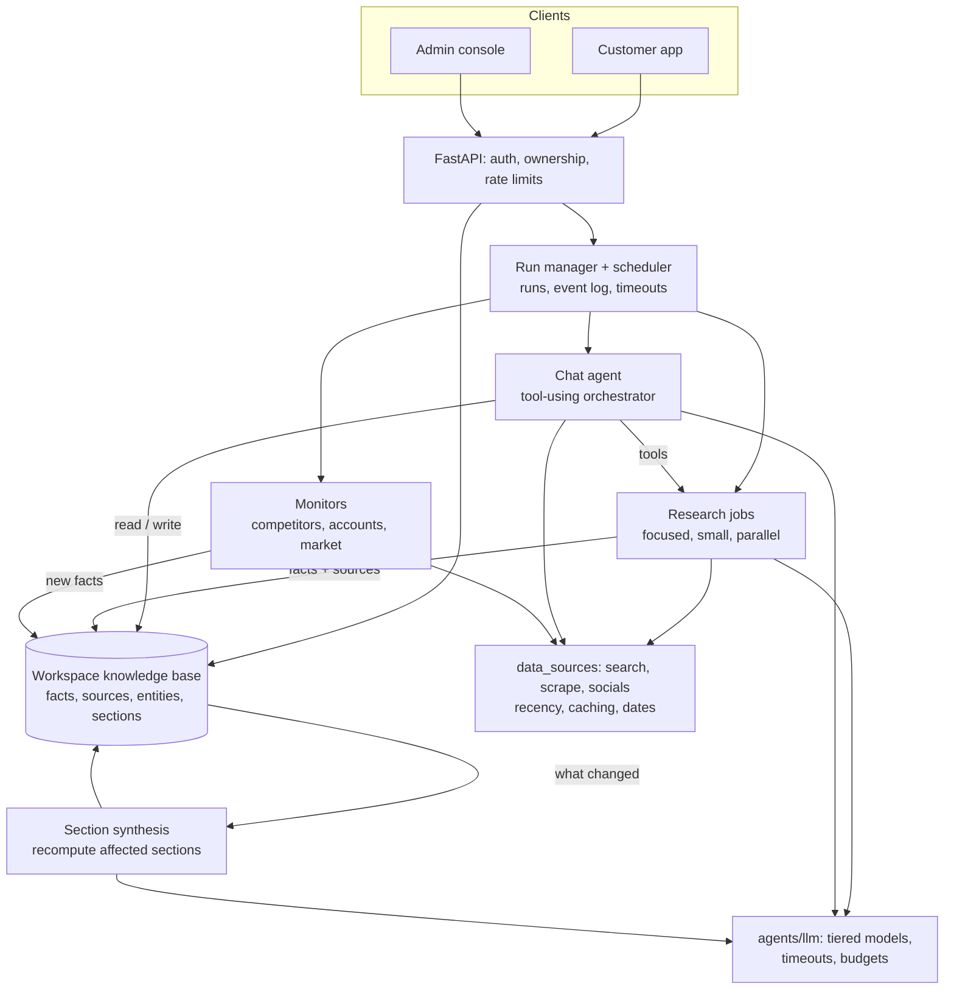
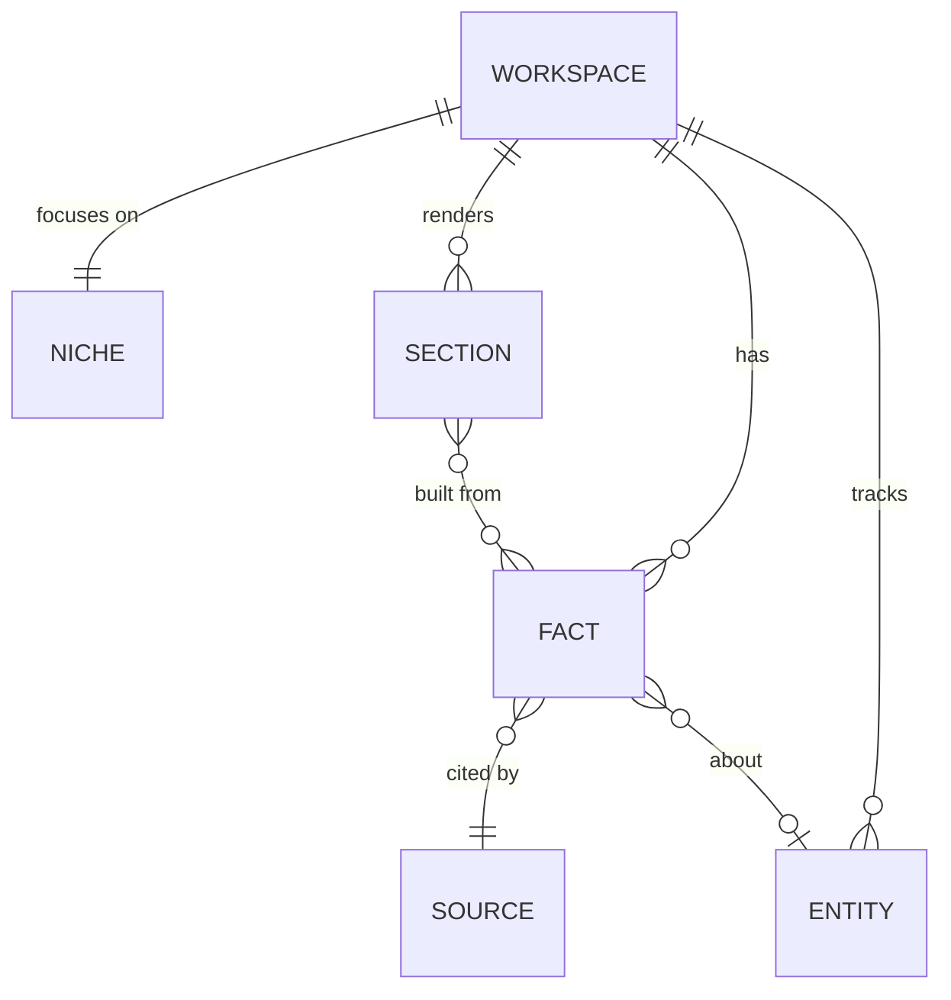
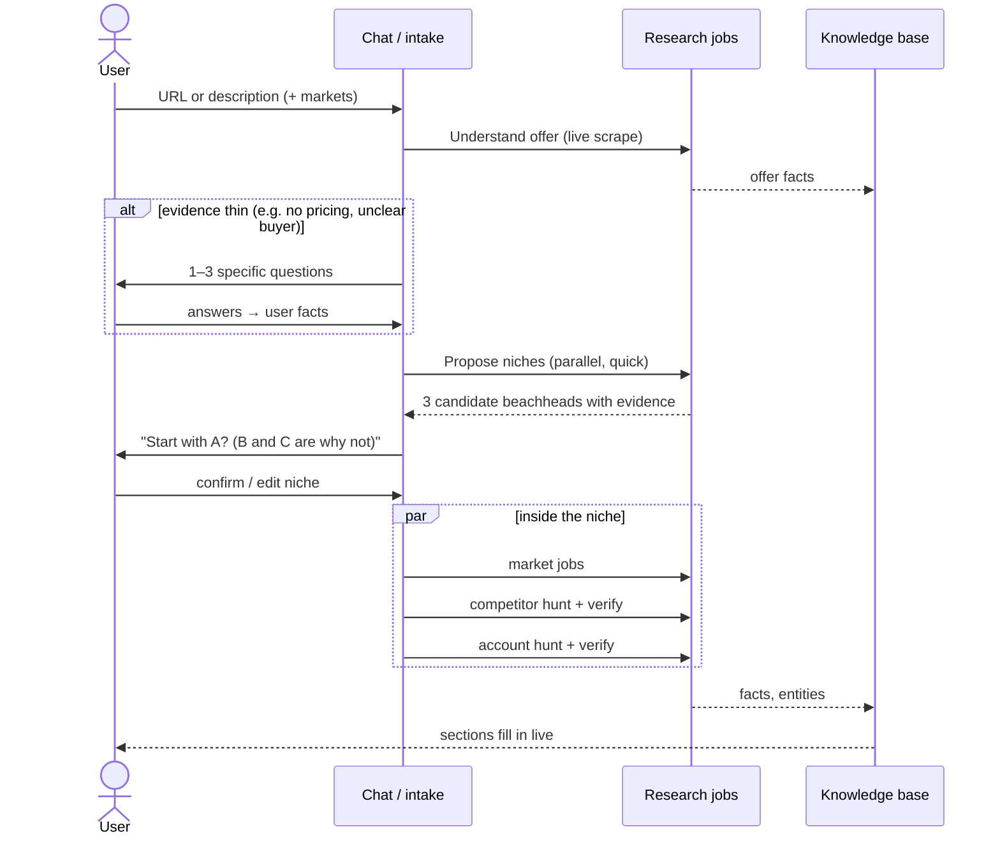

# Thalace v2: architecture proposal

**Status:** draft for review. Nothing here is built yet. Comment on the PR, or
edit this file on the branch.
**Baseline:** `v1.0.0-pilot` (what the pilot used). **Target:** `v2.0.0`.

---

## 1. What the pilot told us, and why v1 behaves that way

| # | Pilot feedback | Why v1 does this (in the code today) |
|---|---|---|
| 1 | Fetch the most recent data | Sources keep no publish date (`data_sources/scraping/exa.py` passes `start_published_date` in, but nothing records a date on the evidence). The offer stage has no recency limit at all. Market and competition use a fixed 365-day window. Results come from Exa's cache unless a page is scraped directly. |
| 2 | Focus on a niche; too broad now | The ICP is the *last* stage (`determine_icp`). Offer, market and competition research all run before any niche exists, so they research the whole category. The ICP's `beachhead` is one line of text that nothing downstream reads. |
| 3 | Ask for more when data is thin | The pipelines are linear by design, with no check on whether the evidence is enough. `understand_market.py` says so: "There is no re-planning loop and no sufficiency gate". The agent can stop to ask the user only during intake (`discover_offer*`). |
| 4 | Improve the chat, where people spend most of their time | Chat routes the question to a specialist, who writes one answer (`agents/pipelines/chat/workspace_chat.py`). It sees the discovery text and 12 turns of history. It can't see tracked competitors, accounts, signals or outreach, and it can't *do* anything: add a competitor, start research, draft a message. The answer appears only once it's complete. |
| 5 | Be accurate on competitors and potential clients | Competitors and accounts come from search and extraction against a broad category (see 2). There are filters (a real website, dedup, self-exclusion, a substitute check), but nothing confirms a candidate is a fit *for the chosen niche*, and no confidence is shown. |
| 6 | Information added after discovery should be used | Insights are one JSON blob (`product_profiles.insights`), replaced whole when a discovery run finishes (see the comment in `models.py`). Information added later can't go anywhere except a full re-run. |
| 7 | Take less time | One discovery is a 6-stage chain: intake, specialists, offer and market in parallel, competition with an ICP draft in parallel, then the final ICP. The user sees nothing useful until the end, and every run starts from nothing. |

Points 2, 3 and 6 are structural. They can't be patched inside the current
pipelines, which is why this is a redesign and not a v1.1.

---

## 2. Principles

1. **The workspace is a knowledge base that grows, not a report.** Every claim is stored as its own fact, with its source, publish date, the date we fetched it, and a confidence level. Pages and chat answers read from the facts.
2. **Choose the niche first.** The first real output is a narrow beachhead (one segment, one geography, one buyer) that the user confirms. Every later step researches *inside* it.
3. **Enough evidence, or a question.** Every research step ends by judging whether it has enough. If not, it searches more within a limit, or asks the user a specific question. It never fills gaps with guesses.
4. **Recent by default.** Searches are limited by date according to how quickly each kind of fact goes stale. Every fact shows its date, and stale facts are flagged and refreshed.
5. **Chat is the main way users work.** The chat agent can read the whole workspace and act through tools: research, add, verify, draft. The page tabs show the same facts.
6. **Incremental, not all over again.** New information (from the user, a monitor or chat) becomes facts, and only the sections that depend on them are recomputed.
7. **Fast first answer, more detail afterwards.** A usable workspace in minutes, with the deeper research arriving in the background and shown as it lands.

---

## 3. Architecture overview

The parts, and what replaces what:

| v2 part | Replaces in v1 | Job |
|---|---|---|
| **Knowledge base** | The `product_profiles.insights` blob, parts of `competitors`/`accounts` | Facts, sources, entities (competitors, accounts, people), the niche, and the synthesised sections |
| **Research jobs** | The 6 large discovery pipelines | Small single-purpose jobs (e.g. "pricing norms for X in Kenya") that return facts, decide whether they have enough, and run in parallel |
| **Section synthesis** | The final write-ups at the end of each pipeline | Rebuilds a section (Offer, Market, Competition, ICP) from its facts, only when those facts change |
| **Chat agent** | The route-then-answer chat | A tool-using agent, with streaming answers, that can read everything and start actions |
| **Verifier** | Ad-hoc filters in `get_competitors` / `account_discovery` | One shared step that checks a candidate company is real and fits, using the evidence, and gives it a confidence score |
| **Monitors** | Competitor monitoring, client moves | Same job, but they write facts, so updates flow into sections and chat |

---

## 4. The knowledge base (points 1, 5, 6)

New tables. Anything we filter or sort on is a real column, and JSON is used
only for opaque agent output.

- **source**: url, title, `published_at` (nullable when unknown), `fetched_at`, kind (web, user, social, connected account), plus a content hash for dedup.
- **fact**: workspace, `topic` (offer, market, competition, icp, account, competitor…), `claim` (one sentence), `source_id`, `confidence` (high, medium or low), `origin` (research, user, monitor, chat), `valid_as_of`, and `superseded_by` (a newer fact replaces an old one without deleting it).
- **entity**: a competitor, account or person, with an identity key (domain), `status` (suggested, confirmed, rejected), a fit score with reasons, and a verification state. `competitors` and `accounts` stay as tables in phase 1. Migrating them is a later phase, done expand → migrate → contract.
- **niche**: the confirmed beachhead (segment, geography, buyer role, the problem it has, and what's excluded), plus the alternatives considered.
- **section**: the synthesised text for each tab (Offer, Market, Competition, ICP), the facts it was built from, and `stale` (true when one of those facts changed).

**What this gives us:**
- Every claim in the UI can show "source · March 2026" (point 1).
- New information (point 6) becomes facts, and the affected sections are marked stale and rebuilt.
- Accuracy (point 5) becomes visible: a confidence level per fact, a verification state per entity, and the user can reject wrong ones, which future research avoids.

**How fresh each kind of fact must be** (settings, not hard-coded):

| Kind of fact | Search window | Re-check after |
|---|---|---|
| News, funding, hiring, launches (account and competitor triggers) | 90 days | 7 days |
| Pricing, competitor positioning | 12 months | 30 days |
| Market size, demand, regulation | 24 months | 90 days |
| What the offer is (its own site) | live scrape | when the user changes it |

---

## 5. Workflows

### 5.1 New workspace (points 2, 3, 7)

- **Stage 1, about 2–4 minutes:** offer understood, questions asked if needed, niche proposed. This is the only part the user waits through.
- **Stage 2, in the background:** market, competitors and accounts research *within the niche*. Sections appear as they're ready, and the user can chat while this runs.
- **The niche confirmation** is the key new step for point 2. Proposing three niches and recommending one gives the user a decision instead of a broad report.

### 5.2 Adding information later (point 6)

The user says it in chat ("we also sell to hospitals", "our price is now
KES 5,000/month"), uploads a document, or edits a fact on a page. Then:

1. The information is turned into facts with `origin=user` (user facts outrank web facts on the same point).
2. Facts it contradicts are marked superseded.
3. The sections built from the changed facts are marked stale and rebuilt, in seconds, not a new discovery.
4. If the change affects the niche (a new segment), the agent asks whether to research it, and if so starts only those jobs.

### 5.3 A chat turn (point 4)

The chat agent is one model call that can use tools, in a loop with a limit
(at most N tool calls, and a time cap):

| Tool | What it does |
|---|---|
| `search_knowledge(query, topic?)` | Searches workspace facts, entities and sections |
| `web_search(query, recency)` | Recent web search, when the facts don't cover it |
| `add_information(text)` | Turns what the user said into facts, as in 5.2 |
| `research(question)` | Starts a background research job; the answer arrives later in the thread |
| `find_competitors` / `find_accounts(criteria)` | Starts a hunt inside the niche |
| `add_or_reject_entity(…)` | Confirms, adds or rejects a competitor or account |
| `draft_outreach(account_ids)` | Hands off to the existing outreach drafting |

- **Answers stream** token by token over the existing run events. The specialist personas stay as the *voice*, but one agent with tools replaces routing plus consultations.
- **Actions are confirmed:** anything that writes or starts a paid job shows as an in-chat button for the user to confirm, as the pilot UI already does for some actions.

### 5.4 Verification (point 5)

Every competitor or account candidate goes through one shared verifier before
the user sees it:

1. **It exists:** a working website, not our own domain, not already rejected by the user.
2. **It's a fit:** it matches the niche (segment, geography, size), checked against what its own site says, not the search snippet.
3. **There's a reason now** (accounts only): a dated trigger within the recency window that names this company.
4. **Confidence:** high, medium or low, with reasons, shown in the UI. Low-confidence candidates go in a "needs review" list instead of the main list.

---

## 6. Speed (point 7)

- **Measure first.** Phase 0 records the time of every stage and every LLM and search call into the existing `llm_calls`/`api_calls` tables. We set targets from the real baseline.
- **Less waiting:** only stage 1 (5.1) blocks the user. Everything else runs in the background and fills in live.
- **Smaller jobs, more of them in parallel,** each with a time budget. A slow job delivers partial facts instead of holding up the run.
- **Re-use:** search and scrape results are cached for each kind of fact's freshness window. A refresh re-runs only stale facts.
- **The right model for each call:** extraction and checks use the cheap, fast tier, and only synthesis and chat use the flagship. Calls that can't block the user get lower priority.
- **Proposed targets, to confirm after Phase 0:** first useful screen (offer plus niche) in **under 4 minutes**, full workspace in **under 10**, chat's first token in **under 3 s**, and a fact-only chat answer in **under 15 s**.

---

## 7. What stays as it is

- Supabase Auth, Postgres, Alembic, and the ownership rules in `api/deps.py`.
- The run manager, the event log, scheduler, rate limits and quotas.
- `agents/llm` (provider ladder, retries, usage accounting) and `data_sources/` (extended with dates and caching).
- Connected accounts (Composio), outreach drafting, sending, and inbox sync.
- The waitlist page and the admin console. The admin console gains views for jobs and facts.
- The rules in `CLAUDE.md`: layers, schemas in one place, no silent failures, every call bounded.

The dependency direction is unchanged: frontend → backend → agents →
data_sources. The knowledge base lives in the backend, and agents receive and
return plain models (`agents/schemas/`), so they stay pure and testable.

---

## 8. Build plan

Each phase is a set of small PRs into `dev`. `main` stays on `v1.0.0-pilot`
until phase 5. A pilot hotfix goes `main` → `v1.0.x` → merged back into `dev`.

| Phase | Branches (examples) | Delivers | Done when |
|---|---|---|---|
| **0. Baseline** | `chore/v2-timing-baseline` | Stage and call timings; a small benchmark set of 5–10 real offers from the pilot | We have v1 numbers for speed and for competitor/account accuracy |
| **1. Knowledge base** | `db/v2-knowledge-base`, `feat/v2-sources-with-dates` | Tables in §4, dates on all sources, write facts alongside the v1 blob (dual-write) | New runs produce facts; v1 pages unchanged |
| **2. Research jobs + niche** | `feat/v2-research-jobs`, `feat/v2-niche-step`, `feat/v2-sufficiency-gate` | Small jobs with an evidence check and questions; niche proposal and confirmation; section synthesis | A new workspace goes intake → questions → niche → sections, and meets the stage-1 time target |
| **3. Chat agent** | `feat/v2-chat-tools`, `feat/v2-chat-streaming` | Tool-using chat (5.3), streaming, `add_information` with incremental refresh (5.2) | Telling chat a new fact updates the right section without a re-run |
| **4. Verifier + entities** | `feat/v2-verifier`, `feat/v2-entity-review` | The shared verifier (5.4), confidence in the UI, reject → learn | On the benchmark set, competitor and account accuracy beats the phase 0 numbers |
| **5. Cut-over** | `db/v2-migrate-v1-workspaces`, release PR | Convert v1 workspaces (blob → facts and sections), remove v1 pipelines, `dev` → `main`, tag **v2.0.0** | Pilot users' workspaces open in v2 with nothing lost |

Phases 3 and 4 can run in parallel once phase 2 lands.

---

## 9. Decisions needed from you

1. **Niche step:** should the user *have to* confirm a niche before research continues (recommended), or should the agent pick one and let them change it later?
2. **Asking questions:** what's the most questions per stage before the agent proceeds with what it has? I propose **3**.
3. **Chat actions:** which actions need a confirm button? I propose everything that costs money or writes data, and none for reading or searching.
4. **Specialists:** keep the four named specialists as chat voices (recommended, since the pilot knows them), or one "Thalace" voice?
5. **Old workspaces:** migrate pilot workspaces into v2 (more work, nothing lost), or start fresh and keep v1 workspaces read-only?
6. **Speed vs depth:** if the 4-minute stage-1 target means less research up front, is that acceptable as long as the rest arrives in the background?
7. **Documents:** should "add information" accept file uploads (PDF decks, price lists) in v2.0, or text only for now?

---

## 10. Risks

| Risk | Mitigation |
|---|---|
| A redesign takes longer than planned while the pilot waits | Phases ship to `dev` independently. Urgent pilot issues use the `v1.0.x` hotfix path |
| A tool-using chat can run up cost | Per-turn limits on tool calls and time, paid actions behind confirmation, existing daily quotas |
| More, smaller jobs means more search and LLM calls | Caching by freshness window, the cheap tier for extraction, and per-run budgets set from the phase 0 numbers |
| Contradicting facts confuse the agent | `superseded_by`, user facts outrank web facts, and the newer dated source wins |
| Migrating v1 blobs is lossy | Dual-write from phase 1, so new workspaces never need migrating; the old blob is kept until phase 5 is verified |
